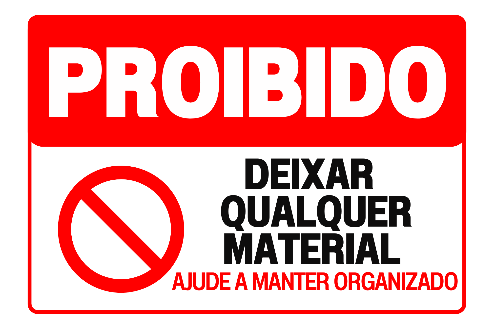
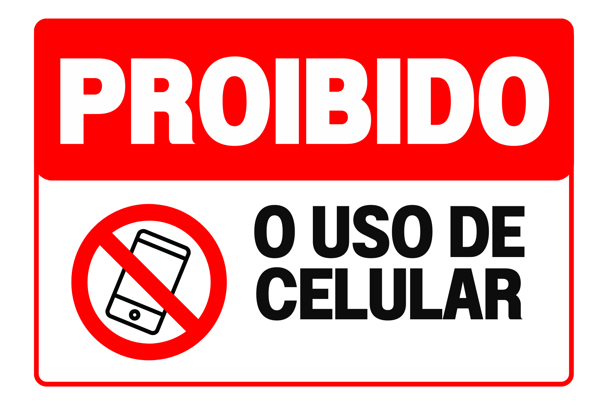
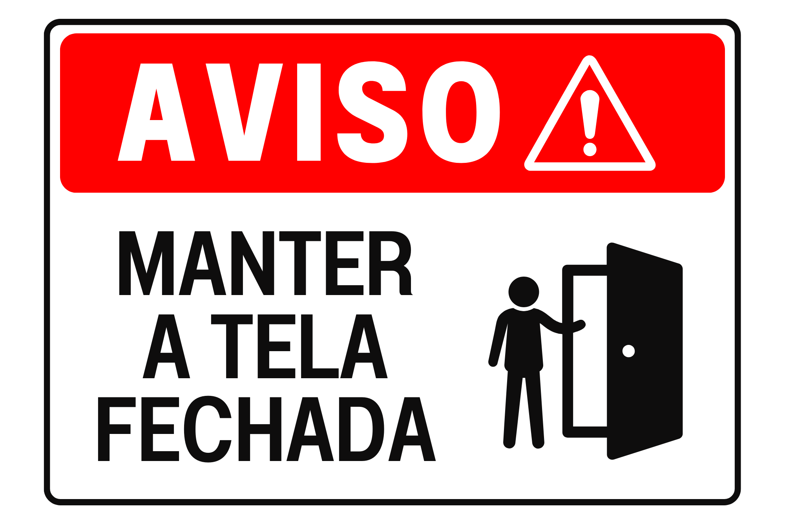
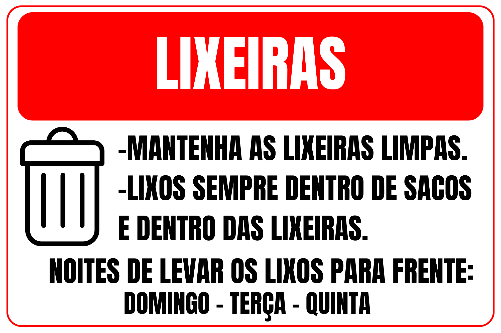
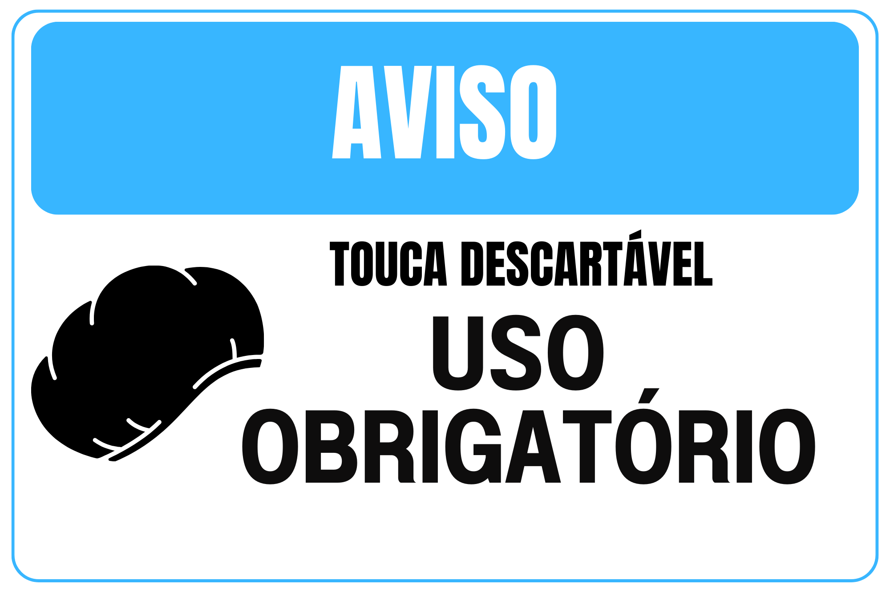
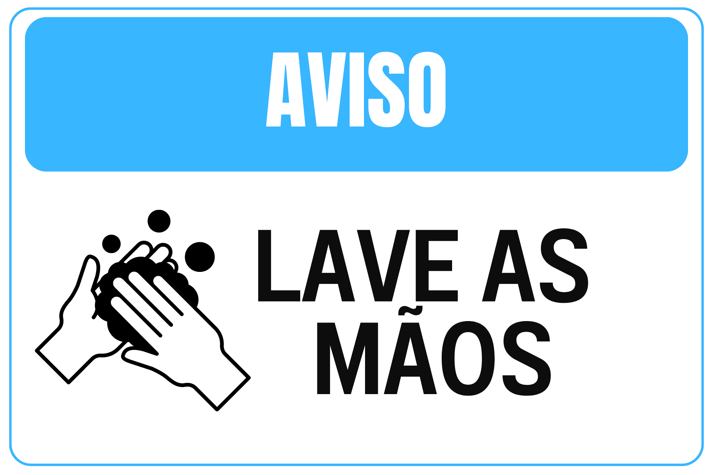
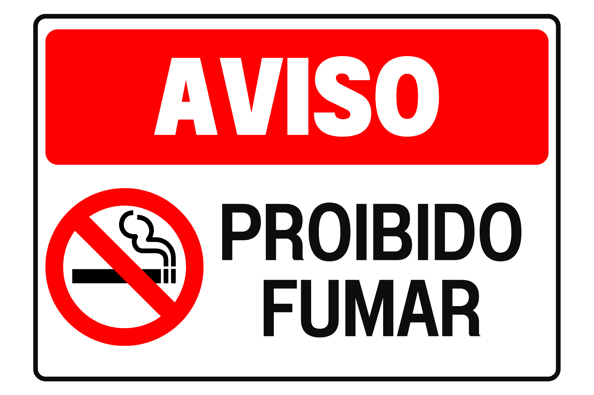

# Documentação Operacional e Padronização — Bruxas Burger

## Contexto

Como chef de cozinha e responsável por atividades de operação, desenvolvi e organizei materiais de referência para apoiar a padronização das rotinas de uma operação de alimentação e sua preparação para franquias.

O trabalho reuniu procedimentos operacionais, instruções de trabalho, manuais, checklists, registros de controle, especificações de produtos e comunicação visual para facilitar a execução consistente das tarefas e o treinamento das equipes.

## Escopo da documentação

- **Manual de operação da franquia:** orientações gerais para a rotina das unidades.
- **Caderno de especificações:** fichas técnicas ilustradas com ingredientes e medidas, etapas de preparo, utensílios e referências de embalagens para delivery.
- **Instruções de Trabalho (ITs):** orientações para higiene de uniformes e manipuladores, recebimento de matérias-primas, preparo de alimentos, pré-preparo, resfriamento, descongelamento, monitoramento de temperatura, identificação e higienização de hortifruti.
- **Procedimentos Operacionais Padronizados (POPs):** higienização de instalações, equipamentos e utensílios; controle de vetores e pragas; higienização do reservatório de água; higiene e saúde dos manipuladores; recebimento de mercadorias; manejo de resíduos; higienização e preparo de hortifruti; abertura e fechamento da unidade; controle de temperatura de freezers e refrigeradores.
- **Checklists e registros:** recebimento de matérias-primas, produtos e embalagens; temperaturas; higiene pessoal; higienização e potabilidade da água; ocorrências de pragas; produção; saída de estoque; e responsabilidade operacional.
- **Comunicação visual para a equipe:** placas sobre organização de materiais, uso de celular, manutenção de portas fechadas, descarte de resíduos, uso de touca descartável, higienização das mãos e proibição de fumar.

## Galeria de placas

### Organização e uso de celular

### Rotina da unidade e descarte

### Higiene e segurança

## Minha contribuição

- Estruturei instruções de trabalho em etapas claras e consultáveis.
- Organizei rotinas de verificação e registros para apoiar a execução e o acompanhamento operacional.
- Criei materiais visuais de orientação para comunicar regras e práticas de rotina.
- Conectei procedimentos, formulários e materiais visuais às atividades diárias da equipe.
- Preparei documentação de apoio à padronização e ao treinamento entre unidades.

## Competências demonstradas

Padronização de processos · Redação de procedimentos e manuais · Operações de alimentação · Controle de qualidade · Checklists e registros operacionais · Treinamento de equipes · Comunicação visual

## Acervo de materiais

Os [materiais de documentação operacional](portfolio/bruxas-burger/README.md) estão disponíveis para consulta e download, incluindo manuais, o caderno de especificações (dividido em partes PDF), Instruções de Trabalho, POPs, checklists, registros e planilhas. Os formulários e planilhas são modelos em branco, sem dados preenchidos de funcionários. Os documentos preservam os créditos profissionais presentes nos originais.

---

**Idioma:** Português  
**Projeto:** documentação operacional e padronização de rotinas para Bruxas Burger.
