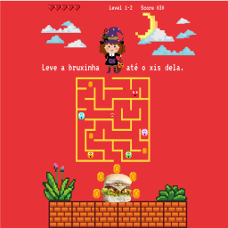
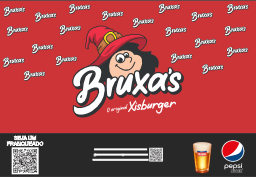
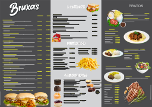
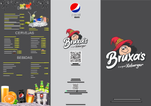
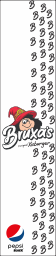
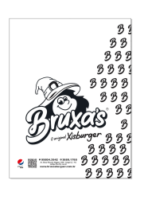
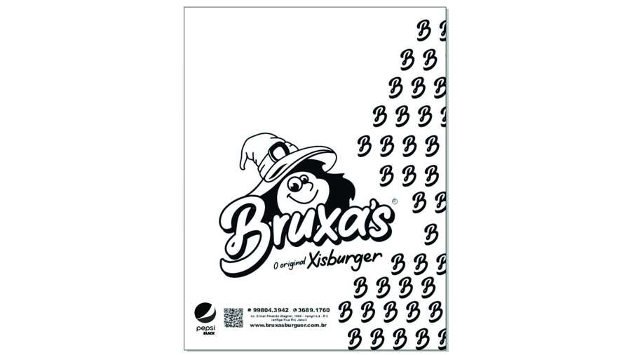

# Artes gráficas para a rede Bruxas Burger

Peças criadas por Sandro Cabelleira no CorelDRAW para embalagens e materiais de cardápio da rede Bruxas Burger.

As imagens abaixo são prévias incorporadas aos arquivos CDR fornecidos. Os arquivos-fonte editáveis publicados estão ligados em cada item.

## Caixa infantil — Jogo da Bruxinha

[Baixar arquivo-fonte CDR](fontes/caixa-kids-jogo-da-bruxinha.cdr)

## Papel de bandeja

[Baixar arquivo-fonte CDR](fontes/papel-de-bandeja.cdr)

## Cardápio — frente

O arquivo-fonte da frente tem aproximadamente 77 MB e não entrou nesta publicação porque o envio direto ao GitHub o rejeitou. A prévia está disponível acima.

## Cardápio — verso

[Baixar arquivo-fonte CDR](fontes/cardapio-verso.cdr)

## Embalagem para talheres

[Baixar arquivo-fonte CDR](fontes/embalagem-talheres.cdr)

## Saco para entrega

[Baixar arquivo-fonte CDR](fontes/saco-para-entrega.cdr)

Foto da peça:

